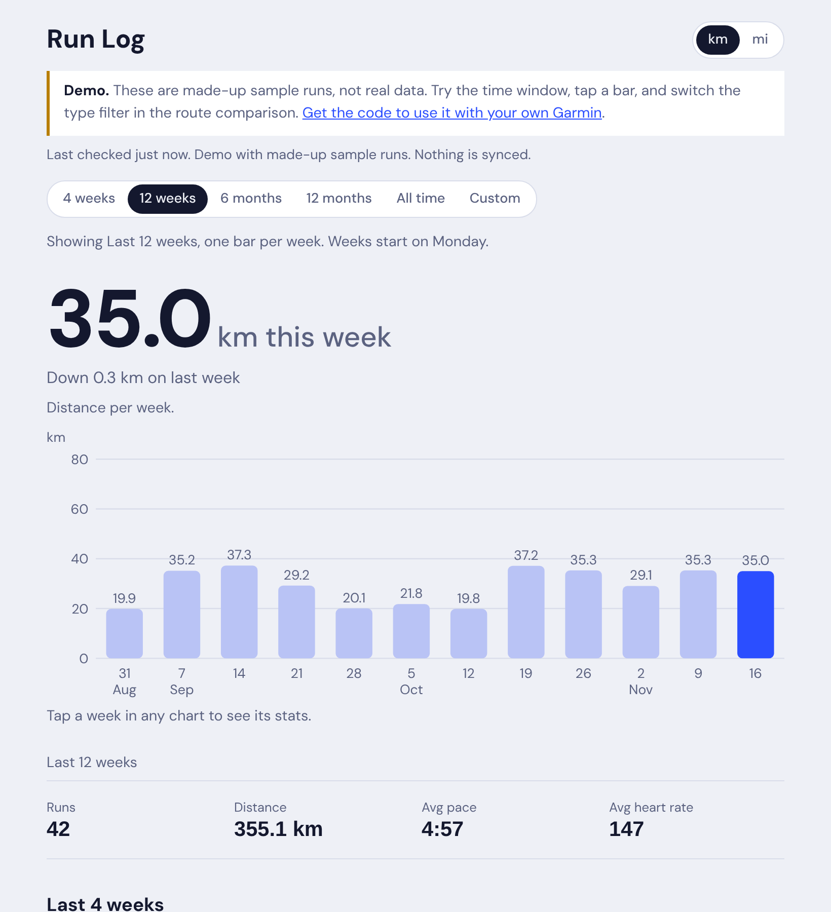
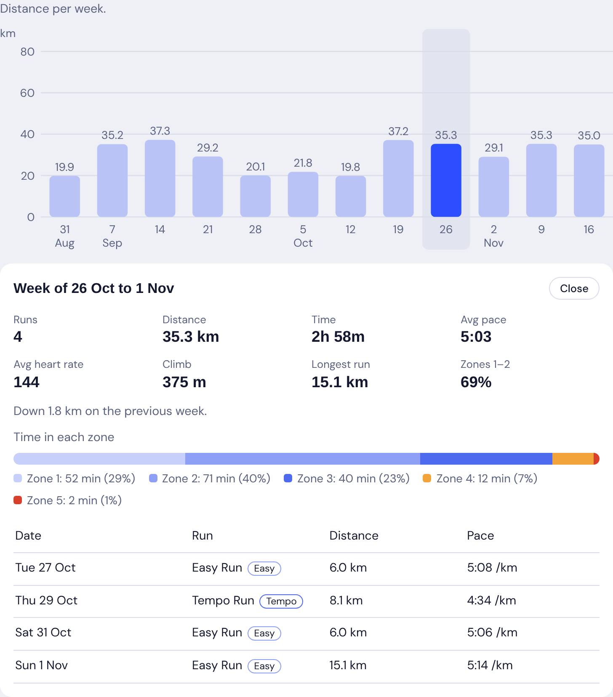
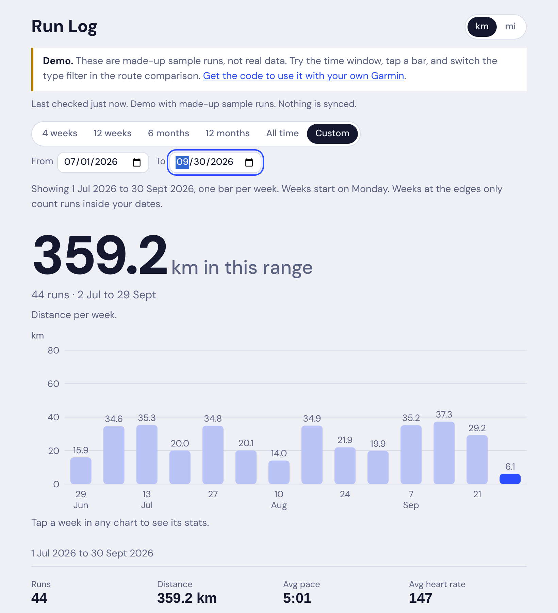
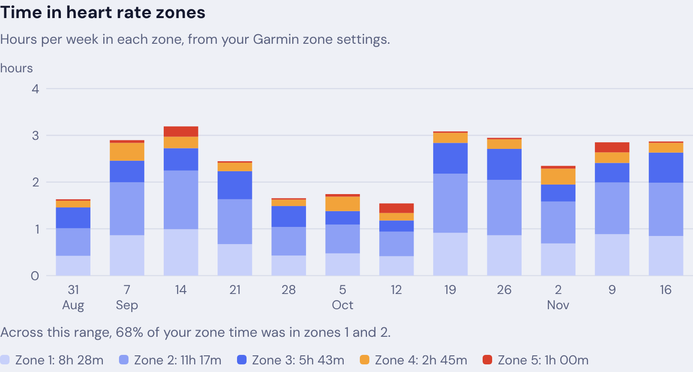
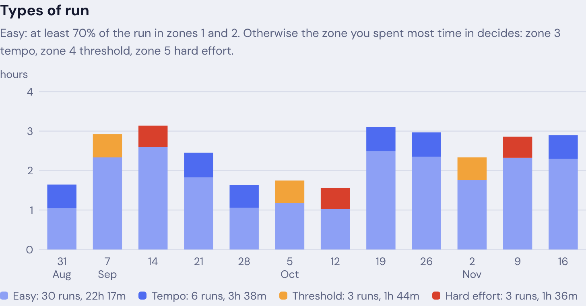
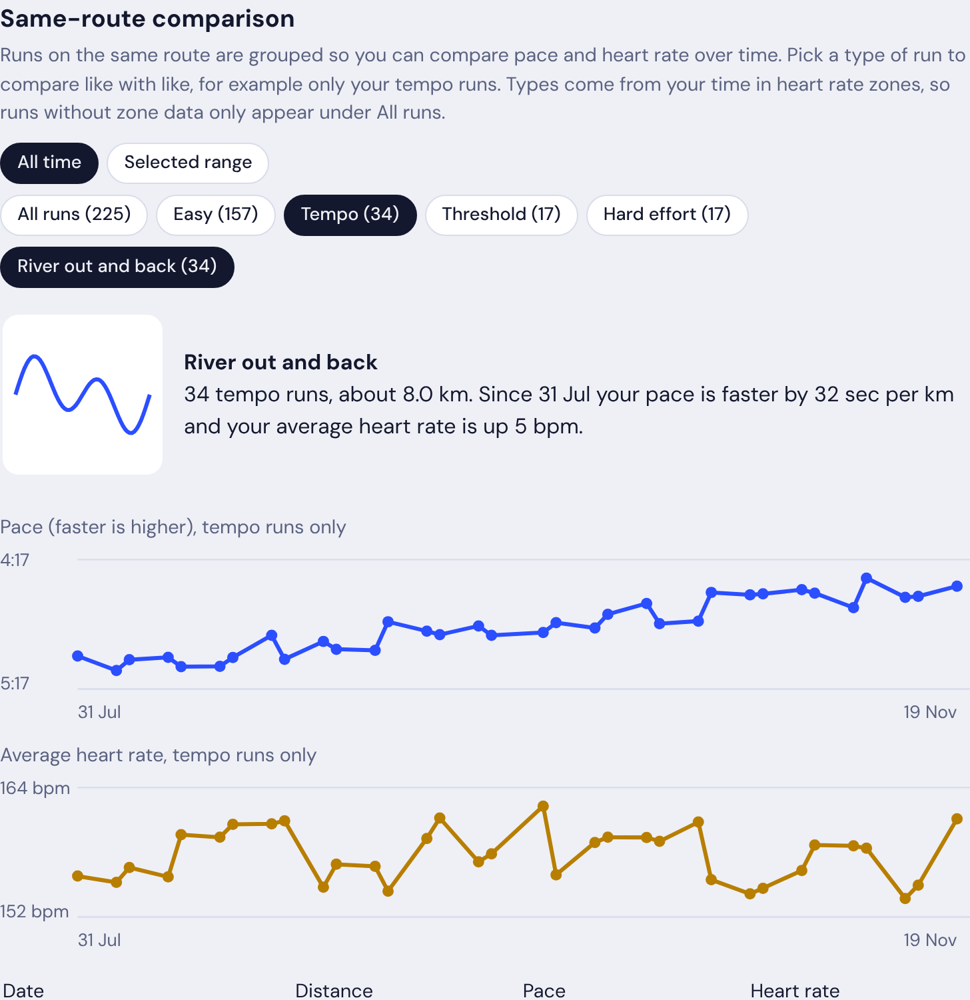

# Run Log

A personal running dashboard for your Garmin data. It copies your runs from Garmin Connect into a local database, keeps it up to date automatically, and shows it in a web page on your own computer: weekly distance and pace, time in heart rate zones, easy/tempo/threshold/hard run types, personal bests, and same-route comparisons on a map. You can pick any date range. Everything stays on your machine.

Built with Python (Flask and SQLite) and a single-page HTML dashboard, with no account or subscription beyond your Garmin login. [Try the live demo](https://gg9761.github.io/Run-Log/) with sample data.

## Garmin import (backend)

Logs in to your Garmin Connect account, then copies your runs, heart rate
zone times and route lines into a local database (`runs.db`).

This uses the unofficial `garminconnect` library. It can break when Garmin
changes its login, and it sits outside Garmin's official terms. Your password
is never saved. Garmin's login tokens are saved in `~/.garminconnect`, so treat
that folder like a password and never share or commit it.

Needs Python 3.12 or later.

## Screenshots

These use made-up sample runs. You can try the same thing in the [live demo](https://gg9761.github.io/Run-Log/).













## Set up

```
python -m venv .venv
source .venv/bin/activate        # Windows: .venv\Scripts\activate
pip install -r requirements.txt
```

## Use it

1. **Log in once:** `python garmin_sync.py login`
   Enter your Garmin email and password. If you use two-step verification,
   enter the code when asked.
2. **Check the data format:** `python garmin_sync.py inspect`
   Prints the raw data for your latest run. If you see `zoneNumber` and
   `secsInZone` in the HR ZONES section, zones will import correctly. If the
   names differ, the import code in `garmin_sync.py` will need adjusting to match.
3. **Import your runs:** `python garmin_sync.py sync`
   Fetches the last 365 days. For a longer history use
   `python garmin_sync.py sync --since 2022-01-01`
   It pauses between requests, so a big history takes a while. You can stop it
   (Ctrl+C) and run it again: it carries on where it left off.
4. **See what you've got:** `python garmin_sync.py summary`

Run `sync` again whenever you want to pick up new runs.

## See it in the dashboard

1. Install the requirements once: `pip install -r requirements.txt`
2. Start the dashboard: `python server.py`
3. Open http://127.0.0.1:5000 in your browser.

The page shows:
- **a time window you can change**: 4 weeks, 12 weeks (the default), 6 months, 12 months, all time, or Custom with your own from and to dates. Up to about 7 months it shows one bar per week, up to about 4 years one per month, beyond that one per year. With custom dates, weeks at the edges only count runs inside your dates. Personal bests are always all-time; the route comparison has an All time / Selected range switch
- distance per week, with every week labelled and the distance on each bar
- **tap any bar** (week, month or year, in any chart, or a week in the 4-week table) for its stats, zone split and runs
- a **last 4 weeks** summary compared with the 4 weeks before
- pace trend, with the pace for each week
- time in heart rate zones 1 to 5, per week
- **types of run** per week (see below)
- personal bests: 1K, 5K, 10K, half marathon and marathon
- same-route comparisons, with a **map** of the route
- your recent runs

The server only listens on your own computer and has no login, so don't put it
online. It works on your phone only when the phone is on the same network and
you run it with changes we haven't made yet, so treat it as a desktop tool for now.

### Automatic sync

While `server.py` is running it checks Garmin for new runs straight away and then
every 30 minutes, fetches anything new (runs, zones, routes), regroups routes and
refreshes the page by itself. The line under the title shows when it last checked.
Press **Sync now** to check immediately.

- `python server.py --sync-every 720` checks every 12 hours instead.
- `python server.py --sync-every 0` turns automatic checking off.

Garmin can't tell us the moment you finish a run, so this works by checking
regularly. A run shows up after your watch has synced to the Garmin Connect app.
It only works while your computer is on and the server is running. If Garmin
stops working, it says so on the page (and uses files in the `exports` folder
if you have put any there). If your Garmin login expires, run
`python garmin_sync.py login` again.

### Types of run

Each run is labelled from its time in heart rate zones:
- **Easy**: at least 70% of the run in zones 1 and 2
- otherwise the zone with the most time decides: zone 3 is **tempo**, zone 4 is
  **threshold**, zone 5 is **hard effort**

Runs with no zone data are left out. To change the 70%, edit `EASY_SHARE` near the
top of the script in `dashboard.html`.

### Personal bests

The server asks Garmin for its own personal records (fastest 1K, 5K, 10K, half
marathon, marathon) when new runs arrive. Where it has one, the page marks it
"Garmin record". Otherwise it shows an estimate from your average pace on runs
at least that long, marked "estimated", which will be slower than a true best.
If you never see "Garmin record", run `python garmin_sync.py inspect` and send
the PERSONAL RECORDS part so the format can be checked.

### Maps

The route map uses Leaflet and OpenStreetMap, loaded from the internet by your
browser. That means OpenStreetMap can see which area you look at. If the map can't
load (for example offline), the page shows a simple outline of the route instead.

### Same-route matching

Two runs count as the same route when they have a similar length, start in nearly
the same place, follow the same path and go in the same direction. A loop run the
other way round counts as a different route.
`python analysis.py routes` lists what it found, and
`python analysis.py rename 3 "Park loop"` renames route 3 (your name is kept
the next time routes are matched). If one route is split in two, loosen the
numbers at the top of `analysis.py`.

## Automatic backup: exported files

If the Garmin login stops working, `sync` notices and switches to importing
files from the `exports` folder instead. It says so clearly, and carries on
with the same database, so nothing else changes. The files can be `.fit`,
`.gpx` or `.zip` files containing them. It never imports the same file or
the same run twice, even if a run arrives from both sources.

The one manual part is getting the files. In Garmin Connect on the web, open a
run and use the gear/menu icon on the activity page: "Export Original" (a zip
with a .fit file) or "Export to GPX". For your full history, look for "Export
Your Data" in your Garmin account's Data Management page. Put the files in
`exports` and run `python garmin_sync.py sync` again, or just
`python garmin_sync.py import-files`.

Useful options:
- `sync --no-fallback` stops with an error instead of switching.
- `sync --folder some_folder` or `import-files --folder some_folder` uses a different folder.

**Zones from files:** Files hold heart rate readings, not zone times, so the
script works zone times out from your zone limits. It reuses the limits from an
earlier Garmin import if it has them. Otherwise copy `zones.example.json` to
`zones.json` and enter the lower heart rate limit of each zone from your Garmin
settings. Without them, runs still import but without zone times.

**Limits of file import:** Start times come from the file's UTC time, so local
times are approximate. Elevation from GPX files is rough. FIT files are more accurate.

## Troubleshooting

- **"Couldn't log in with saved tokens"**: run the `login` command again.
- **Login fails after working before**: Garmin may have changed something.
  Update the library with `pip install --upgrade garminconnect curl_cffi`.
- **Some runs say "skipped"**: they'll be retried on the next `sync`.
- **".fit" files fail**: make sure `fitdecode` is installed (`pip install -r requirements.txt`).

## Sharing this project

- **Live demo:** the `docs/` folder is a version of the dashboard with made-up sample runs. In your GitHub repo, go to Settings → Pages, choose "Deploy from a branch", branch `main`, folder `/docs`. After a minute the demo is at `https://gg9761.github.io/Run-Log/`.
- **Running it with their own data:** a friend downloads the repo, runs `pip install -r requirements.txt`, `python garmin_sync.py login`, `python garmin_sync.py sync`, then `python server.py`. It uses their own Garmin account and keeps everything on their computer.
- **Never commit personal data.** `.gitignore` already excludes `runs.db`, `zones.json`, `exports/` and the Garmin login tokens. The real dashboard needs the local server, so it can't be hosted on GitHub Pages with live data.
